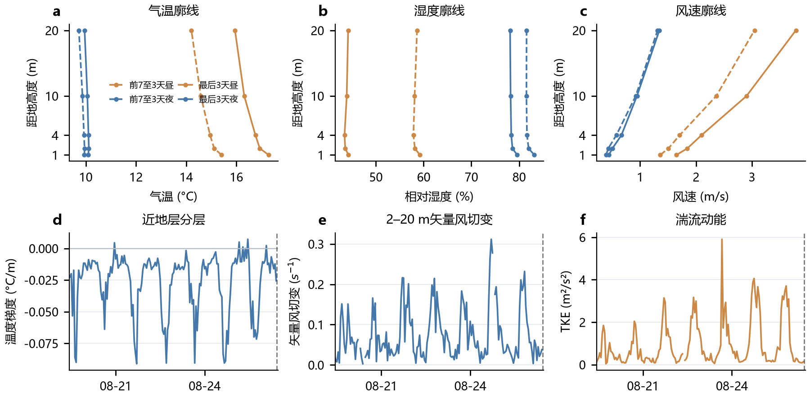
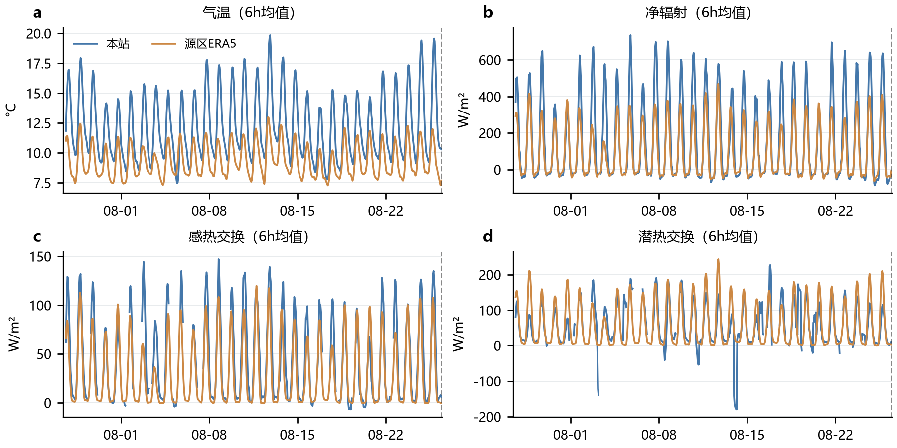
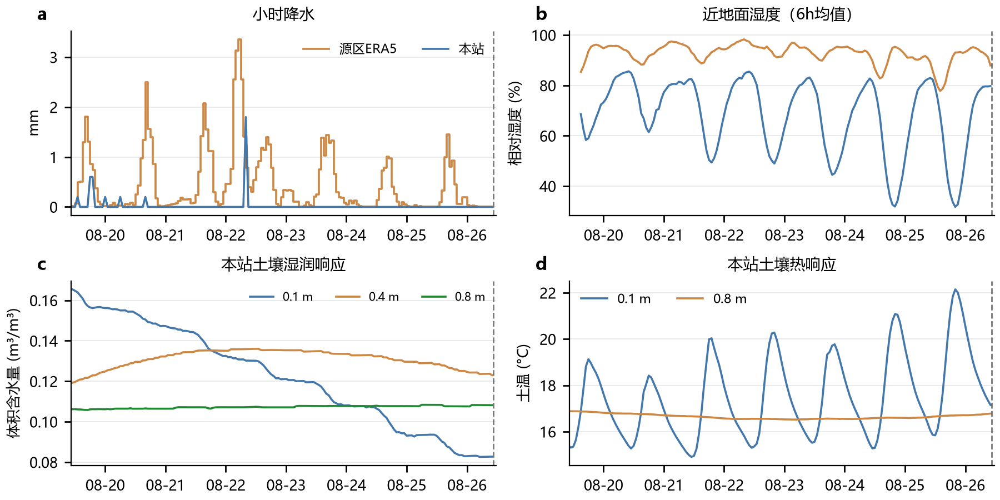
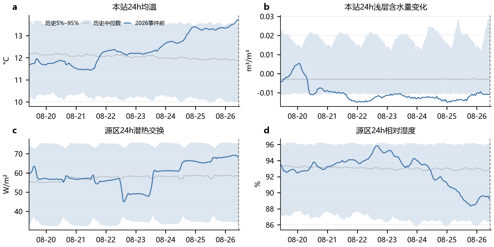
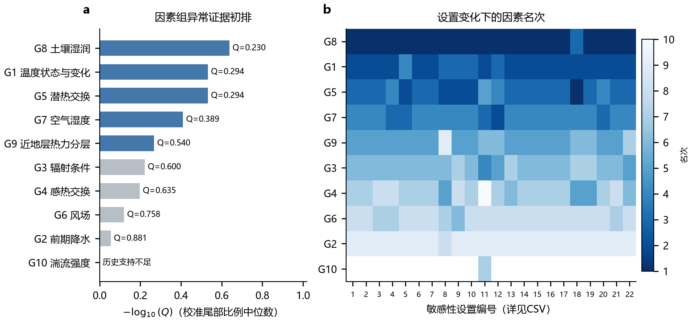
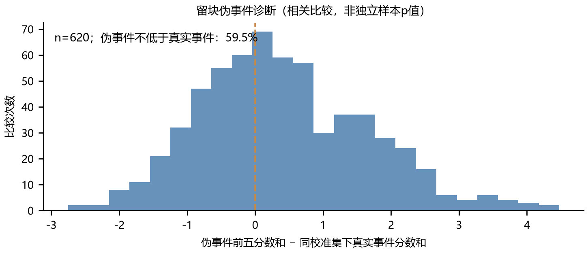

# 第一问完整计算结果

## 结果先读

主方案得到的前五项为：**土壤湿润变化、温度状态与变化、潜热交换、空气湿度、近地层热力分层**。代表指标及数值如下。G1与G5的中位校准尾部比例相同，名次2、3不表示可精确区分其强弱。

|   排名 | 因素      | 代表特征          | 位置     |     事件前值 | 单位     |   历史百分位 |   校准尾部比例中位数 |   设置入选率 |
|-----:|:--------|:--------------|:-------|---------:|:-------|--------:|------------:|--------:|
|    1 | 土壤湿润    | 24h浅层含水量变化    | 本站     | -0.01087 | m3/m3  |   3.871 |       0.23  |   1     |
|    2 | 温度状态与变化 | 24h平均气温       | 本站     | 13.7354  | degC   |  96.129 |       0.294 |   1     |
|    3 | 潜热交换    | 24h平均潜热通量     | 源区ERA5 | 68.2008  | W/m2   |  87.097 |       0.294 |   1     |
|    4 | 空气湿度    | 24h平均2m相对湿度   | 源区ERA5 | 89.2618  | %      |  13.548 |       0.389 |   1     |
|    5 | 近地层热力分层 | 6h平均2至20m温度梯度 | 本站     | -0.01519 | degC/m |  26.452 |       0.54  |   0.727 |

**这些是相对前五，不是五个已经确认的直接致灾因子。** 五项的中位组校准尾部比例均高于0.05；完整筛选程序的620次相关伪事件比较中，约59.5%的伪事件前五分数和不低于在同一校准集下的真实事件。不能认定本次环境组合在该历史基线下具有显著的整体特殊性，更不能据此证明灾害因果。

本文按指定的3.1—3.5结构完成全部计算与叙述。论文源文件见`manuscript/`，5组主要图及可编辑SVG见`results/figures/`，31列字典、全部数值和分折结果见`results/tables/`。

## 3.1 候选物理因素与特征量化方法

使用题给MET、RADM、SOIL、FLUX的24个CSV原始副本，重建63个测量变量的分析视图；新增ERA5-Land13变量、17个月、每变量12528个UTC小时，按清单读取14个核心NC。供方源QC为0的值进入主分析；FLUX无源QC，保留独立质量规则及敏感性结果。源区主格点为28.3°N、85.5°E，由参考冰川掩膜几何中心28.2869°N、85.5316°E确定，未按异常大小选点。

主格点模式地形约4167m，参考冰川掩膜内高程中位数约5297m，模式冰川比例约7.32%。格点明显混合较低地形和非冰川下垫面；本项目的源区ERA5实际指源区邻域环境背景，不能当作高位冰崖热状态或冰面通量。

| 因素组        | 指标                | 指标家族    |   列数 | 研究视角      |
|:-----------|:------------------|:--------|-----:|:----------|
| G1 温度状态与变化 | 24h均温、相邻24h温差     | M01,M02 |    4 | 过程、极端性    |
| G2 前期降水    | 24/72/168h累计降水    | M03     |    6 | 过程、极端性    |
| G3 辐射条件    | 24/72h净辐射能、24h净长波 | M04,M05 |    6 | 过程、极端性    |
| G4 感热交换    | 24h平均感热通量         | M06     |    2 | 交换、过程     |
| G5 潜热交换    | 24h平均潜热通量         | M07     |    2 | 交换、过程     |
| G6 风场      | 6h均风、24h最大小时风速    | M08     |    4 | 结构、过程、极端性 |
| G7 空气湿度    | 24h平均相对湿度         | M09     |    2 | 结构、过程     |
| G8 土壤湿润    | 24h浅层含水量及端点变化     | M10,M11 |    2 | 陆面响应      |
| G9 近地层热力分层 | 6h平均2—20m温度梯度     | M12     |    1 | 结构        |
| G10 湍流强度   | 6h平均TKE及摩擦速度      | M13,M14 |    2 | 结构        |

统一算子为 $\overline X_w(t)=n_w^{-1}\sum_{k\in\mathcal V_w}X(t-k)$、$C_w(t)=\sum_{k=0}^{w-1}x(t-k)$、$\Delta T_{24}=\overline T_{24}(t)-\overline T_{24}(t-24)$。独立组合量为 $R_n=R_{sd}-R_{su}+R_{ld}-R_{lu}$、$E_{R,w}=0.0036\sum R_n$（MJ/m²）、$G_T=(T_{20m}-T_{2m})/18m$。浅层含水变化为 $VWC(t)-VWC(t-24h)$；风切变先将风速风向转为水平矢量，再取 $\sqrt{(u_{20}-u_2)^2+(v_{20}-v_2)^2}/18m$。完整31列逐项定义见 `results/tables/feature_catalog.csv`。

按照10个物理组、14类指标定义实现31列：本站18列、源区13列。均值要求至少90%有效且没有整段6h全空；完整累计与极值不容许缺小时。相邻24h均温差、四分量净辐射、2至20m温度梯度均由同时段数据计算。主截点为北京时间2026-08-26 10:00，事件参考为10:30。本站标签保守视为起点，原始09:00行对应10:00结束；标签为终点的解释已列为敏感性。

站点时间转UTC后与ERA5对齐；ARCO的降水与向下短长波已是小时增量，不二次反累计；原CDS的净短长波、感热和潜热按01UTC周期重置及00UTC前日总量规则反累计。相同格点坐标先规范小数精度，避免跨通道错误对齐。本站热通量供应符号未核实，源区按向上为正输出；两地通量不进行未经定义确认的方向归因。

文献用于界定可观测过程而非指定答案：Srivastava等的单事件气象分析启发了温度、风、辐射和湍流过程；Zhong等的源区/轨迹划分提醒不能将不同空间对象的量直接替换。没有将文献模型重要性或触发数值移植为本题结论。

## 3.2 大气边界层结构特征分析

灾前7天观测站呈明显昼夜差异。按原始北京时间11—17时和00—06时分组，最后3天的2m白天气温为16.94℃，20m为15.95℃；夜间分别为10.12℃和9.95℃。前7至3天的2m白天均温为15.12℃，后3天更暖。昼夜分组为固定钟点描述，不宣称精确日出日落分类。

最后6h的平均温度梯度为-0.01519℃/m，历史同期约第26.45百分位；最后24h平均梯度为-0.02745℃/m。多数时段气温随高度降低，短时可转为弱正梯度。该量仅表征1—20m近地层分层，不足以严格判定完整边界层高度或源区层结。

最后6h TKE为0.1378m²/s²、摩擦速度为0.1304m/s，相对可用历史样本分别处在24.93与40.24百分位，未显示该截点的极端湍流增强。2022年匹配窗口的FLUX候选全部不可用，因而G10不能通过本方案共同年份要求；缺乏组排名不表示湍流没有作用。

矢量风切变最后6h均值为0.0323s⁻¹，低于最后24h的0.0760s⁻¹；TKE最后6h均值也低于最后24h的1.183m²/s²，说明临近截点交换较弱。灾前7天逐小时TKE与风切变、摩擦速度的同步Spearman系数为0.762、0.874；与感热/潜热为0.621/0.568，对应通量领先3h时为0.730/0.643。这些是同一周内含日周期的相关时序描述，不能识别因果时滞，也不参与灾害因素排序；0/3/6h全表见boundary_layer_covariation.csv。

图3-1：本站多高度温湿风廓线与灾前GT/矢量风切变/TKE。虚线与实线区分前7至3天和最后3天；昼夜分别按固定北京时间窗口。时间轴为北京时间，竖线为题设参考时刻。数据来源为`boundary_layer_profiles.csv`与`station_process.csv.gz`。

## 3.3 灾前天气过程与地气水热响应

本站最后24h均温为13.735℃，最后72h为13.232℃，且日变化明显。相邻24h均温差为0.442℃；源区ERA5对应变化为-0.265℃，表明临近截点的短时温变不完全同向，不能将站点回暖无条件外推至源区。两地24h均温在各自历史中的位置均偏高，但源区约第81.94百分位，弱于本站。

本站72h累计净辐射约45.17MJ/m²，源区约26.98MJ/m²。两地都呈日周期与天气调制；它们是不同下垫面和尺度的地表能量交换背景，不能当作实际冰崖融化能量。源区24h向上潜热交换为68.20W/m²，正值表示本项目转换约定下的向上交换，不能解读成同量的冰体融水。

图3-2：灾前30天热状态与地气交换，绘图采用6h滚动均值以便阅读，统计和排序仍严格采用字典中的窗口。本站保留供应通量符号，ERA5向上为正，不能仅凭曲线同号作热流方向验证。

本站前24h与72h降水均为0.0mm，前168h为3.8mm；源区ERA5分别为5.66、20.20、74.50mm。两地明显不同，本站无雨不能代表源区无水源。源区这三项累计量在历史参照中约为第11.6、13.5和33.5百分位，当前格点不支持灾前累计降水异常偏高；格点结果也不能排除局地微尺度强降水。

本站0.1m含水量在灾前7天整体下降，最后24h平均为0.08536m³/m³，端点变化为-0.01087m³/m³。深层变化更缓，浅层土温日振幅较大，体现本地陆面水热响应；未观测到源区基底水压，不能把本站变干解释成冰体失稳的直接水力机制。

## 3.4 极端气象条件与历史异常识别

主参照取2021—2025年8月11日至9月10日相同钟点，共155个名义锚点，逐列保留实际有效数，各年份等权。31列均计算历史分位与经验尾部比例，降水/风速按事先声明考察上尾，其余采用双侧。对同一变量的多个窗口及位置采用一致口径，未把背景日期标为确认无灾样本。

本站24h均温约第96.13百分位，前24h浅层含水量变化约第3.87百分位，分别表示偏暖和较明显的本地干燥变化。在末7天逐小时滚动特征中，本站均温超出同期5%—95%带共4h；含水量变化超带共115h，最长连续60h。这是相关滚动窗口的持续性描述，不是多次独立极端事件。

源区潜热交换约第87.10百分位、相对湿度约第13.55百分位，均未超出事件截点的历史5%—95%区间。本站最大小时风速为5.334m/s，历史约第38.67百分位；不宜称灾前极端强风。土壤和通量的异常也不全部等同“极端天气事件”。

图3-4：阴影是2021—2025年同季节同小时的经验5%—95%带，不是置信区间或预测区间。均温与土壤变化存在局部越界，源区潜热与湿度在历史正常波动范围内；未为配合题目措辞而强行宣布所有因素极端。

## 3.5 灾害关联证据评价与五因素筛选

对五历史年作十种“3年参照＋2年校准”划分。每组对固定可用的候选版本取最大异常，校准历史也执行相同选择。再按有效划分中位校准尾部比例排序，每组最多一项，并检查预先规定的温度/分层及风/湍流耦合对。跨组特征相关仅用于识别冗余，未充当与灾害的相关系数。

### 十组完整比较

| 组   | 因素      | 代表特征          | 事件前值          | 历史百分位      | 校准尾部比例中位数   |   有效划分数 | 主前五   |
|:----|:--------|:--------------|:--------------|:-----------|:------------|--------:|:------|
| G8  | 土壤湿润    | 24h浅层含水量变化    | -0.0108722    | 3.87096774 | 0.23015873  |      10 | True  |
| G1  | 温度状态与变化 | 24h平均气温       | 13.7354167    | 96.1290323 | 0.293650794 |      10 | True  |
| G5  | 潜热交换    | 24h平均潜热通量     | 68.2008216    | 87.0967742 | 0.293650794 |      10 | True  |
| G7  | 空气湿度    | 24h平均2m相对湿度   | 89.2618348    | 13.5483871 | 0.388888889 |      10 | True  |
| G9  | 近地层热力分层 | 6h平均2至20m温度梯度 | -0.0151851852 | 26.4516129 | 0.53968254  |      10 | True  |
| G3  | 辐射条件    | 72h净辐射能量      | 45.1696168    | 89.3972727 | 0.600378673 |      10 | False |
| G4  | 感热交换    | 24h平均感热通量     | 34.6177314    | 69.6774194 | 0.634920635 |      10 | False |
| G6  | 风场      | 6h平均10m风速     | 0.603012728   | 67.0967742 | 0.758146271 |      10 | False |
| G2  | 前期降水    | 168h累计降水      | 3.8           | 40.9677419 | 0.880952381 |      10 | False |
| G10 | 湍流强度    | 不可评估          | 不可评估          | 不可评估       | 不可评估        |       0 | False |

G10历史支持不足是因为2022年匹配FLUX数据缺失；它仍完成了时序、廓线相关分析与可用样本的单列异常评价。剔除2022年的四年敏感性中可评价，但不能倒过来把四年版冒充预先要求的五年主方案。

### 前五因素的解释

1. **土壤湿润变化（G8）**：代表为本站24h浅层含水量端点变化，表现为偏干。统计上相对罕见并持续，但直接测量对象是本站土壤，不是上游冰体或沟床孔压。因此它是区域陆面响应线索，不能称本次冰崩的首要直接原因。
2. **温度状态与变化（G1）**：代表为本站24h均温。本站偏暖且源区均温也偏向自身历史上部，但源区短时温变不完全同步。可作为区域热背景，不能直接推出融化量和失稳时间。
3. **潜热交换（G5）**：代表为源区格点24h均值。当前值处于历史较高但非极端位置；它入选五因素是相对于其他候选的结果，不等于物理贡献排名第三。再分析下垫面和本站符号限制需保留。
4. **空气湿度（G7）**：代表为源区24h相对湿度，较自身背景偏低。本站也相对偏干，但绝对湿度因位置不同而不同；不能用RH下降单独证明水量供应不足或冰体破坏。
5. **近地层热力分层（G9）**：代表为本站6h平均温度梯度。其历史位置并不极端；22种同候选范围设置中约72.7%入选，弱于前四项的稳定性，部分情景由辐射或感热组替代，应列为较弱的第五候选。

22种同范围设置中，G8/G1/G5/G7均入选；另有2种缩小候选位置的对照不混入此分母。十种年份划分彼此共享资料，设置入选率也不是置信水平或致灾概率。全部设置、被替代组、历史样本数、候选可用性和去冗余记录均随代码交付。

完整伪事件诊断中，真实事件的前五组合并没有持续优于历史伪事件：相关比较的超过比例为59.5%。故本题在现有单事件资料下可以给出上述可复现的相对候选排序，但不能宣称识别了五个已证实的触发原因。尤其本站远离源区、ERA5不能解析冰崖微尺度、气象记录不含地质力学状态，这些是本结论的具体适用边界。

## 复现与完整性

1. 在本文件夹创建Python环境并安装`requirements.txt`，执行`python run.py`即可从复制的原始数据重建全部分析、图表、报告和LaTeX源；有XeLaTeX时同时编译PDF。
2. `python -m unittest discover -s tests -v`检查日重置、跨缺月、缺值传播、窗口完整性、零值、经验比例与候选全集；`python scripts/verify_outputs.py`核查交付和输入哈希。
3. 程序运行不下载数据、不读外部工作区、不访问密钥。原始副本通过相对路径哈希清单追溯。虚拟环境不是研究数据，便携压缩包不包含它。
4. 输出目录：`results/tables/`完整数值；`results/figures/`PNG/PDF/SVG；`manuscript/`五节正文与独立PDF；`reports/`口径与验证；`data/raw/`原始副本；`data/input/`派生输入；`scripts/`实现。

## 来源与说明

- 原题、24个观测CSV、13项ERA5资料和两篇参考论文原文均在项目中保存，模型格点参考不等于实测释放区。
- 本站数据DOI：10.11888/Atmos.tpdc.303600。
- ECMWF ERA5-Land及ARCO累计规则见`docs/official_sources.json`；热通量方向另核对[ECMWF参数146](https://codes.ecmwf.int/grib/param-db/146)。
- Srivastava等（2022），DOI 10.3390/atmos13020267；Zhong等（2025），DOI 10.1007/s10346-024-02421-7。文献支持候选动机，不替代本次数值筛选。
- 本章为单事件事后环境关联分析；未估计触发阈值、未来时间概率或动力学传播。
