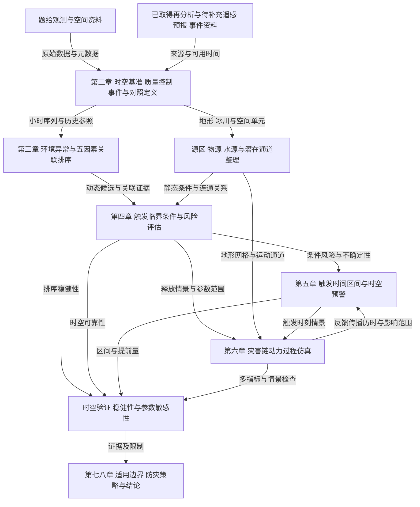

# MathorCup赛道B前两章写作设计

设计日期：2026年10月27日。适用项目：`C:/Users/21800/Desktop/mathor/MathorCup2026`。

本设计沿用现有章节和交叉引用标签，不替换现有TeX正文。目标是让第一章提出明确问题和研究路线，让第二章给出可信、可复现的数据基础，并自然进入第三章的因素识别。引用材料来自“md合集”、本地原题、已读论文及实际下载和清洗报告；不把研究计划写成已取得的结果。

## 一 总体安排

### 1 一句话论证主线

围绕吉隆冰岩崩向泥石流演变的灾害链，本文拟结合塔站观测、源区参考格点及地形冰川资料，依次开展环境异常关联分析、触发条件评估、时间与空间预警及动力过程模拟，并将结论限制在数据可支持的时空范围内。

这是写作阶段的研究主线，不是已经完成的成果声明。最终摘要与结论仍需根据实际结果改写。

### 2 保留现有章节结构

| 章与节 | 主要回答什么 | 主要内容 | 后续接入位置 |
|---|---|---|---|
| 1 引言与问题分析 | 为什么研究、需要解决什么、总体怎么做 | 背景与文献、四问难点、技术路线 | 第3—6章 |
| 1.1 研究背景与灾害链特征 | 研究对象和科学问题是什么 | 灾害链机制、已有工作与未解决问题 | 为四问建立共同背景 |
| 1.2 研究任务与关键难点 | 赛题怎样转成可分析的问题 | 四问输入、难点、输出与验证目标 | 每问的模型章节 |
| 1.3 总体技术路线 | 四问如何共享和传递信息 | 共用数据层、分析模块、反馈与验证 | 各模型的接口 |
| 2 研究区域、数据体系与预处理 | 我们的数据能说明什么、如何处理 | 空间对象、数据来源、质量控制、事件基准与假设 | 第3章的数据入口 |
| 2.1 研究区域与空间单元划分 | 站点、源区、通道和口岸分别在哪里 | 多层空间对象及覆盖限制 | 空间评估和传播仿真 |
| 2.2 多源数据及其时空特征 | 数据是什么、来自哪里、已取得多少 | 一张核心数据表和来源分组 | 各问输入依据 |
| 2.3 数据质量控制与统一 | 如何由原始文件得到可用数据 | 缺失、QC、时间、累计量、单位和坐标 | 可复现分析 |
| 2.4 灾害事件时间轴与对照样本构建 | 事件时刻与历史参照如何定义 | 时间冲突、观测可用时刻、匹配对照 | 异常分析与预测验证 |
| 2.5 模型基本假设与符号约定 | 哪些简化成立、通用符号指什么 | 少量有用假设及共同符号 | 避免模型间歧义 |

**篇幅建议：** 第一章约1000—1400字，第二章约1600—2200字；加上表图，初稿争取约4—5页，实际以模板渲染为准。这是篇幅控制建议，不是竞赛官方页数限制。不要把所有数据审计日志、文件大小和63字段清单堆进正文。

### 3 章节边界

- 第一章可写研究方法的选择理由，不写最终前五因素、权重、阈值、覆盖率或仿真结果。
- 第二章可写真实完成的数据统计和清洗步骤；质量诊断是数据证据，不等于提前公布模型结果。
- 第三章再写14类主候选、6类扩展候选的公式、窗口、历史异常、去冗余和最终排序。
- 第四章再写静态易发性、动态触发边界和时空可靠性；第五章写时间分布与预警；第六章写方程、参数与数值仿真。
- 文献综述嵌入1.1，不另加一个与现有结构冲突的长篇综述章；四问回顾与数学分析结合放在1.2。

## 二 第一章逐节设计

### 1.1 研究背景与灾害链特征

**建议3段，采用“具体灾害情境—已有研究与能力边界—本文问题”的收束结构。**

**第1段写对象和现实问题，约150字。** 以高位冰岩崩通过沟道向下游泥石流、山洪演变切入，再落到吉隆口岸。说明源区与承灾区分离、沿程物质交换和传播快速，使只在口岸分析降雨不足以覆盖灾害链。不要大篇幅介绍泥石流百科，不急于选算法，也不引用未经核对的伤亡人数。

**第2段写文献中已做到的事，约180—220字。** 不按7篇论文逐篇罗列，按三类能力组织：P1支持气象与地气交换背景分析；P2/P3/P4支持多源灾害链重建；P5/P7支持跨事件的源区和路径条件整理。每组只保留与本题有关的一句话，不堆数值。

**第3段写能力边界和研究切口，约120—180字。** 用P6说明“有变形先兆”不等于“可准确预测触发时刻”。再指出本题存在站点远离源区、变量尺度不同、事件标签不足的问题，因此需要将区域天气关联、源区触发和传播影响分别建模，并在共同框架中联系起来。

**可作为初稿骨架的文字：**

> 高寒山区高位冰岩体失稳后，可在重力势能驱动下发生撞击破碎，并在融水、河道水体及松散物质参与下，逐渐演化为碎屑流、泥石流和山洪。此类灾害的启动区与下游承灾区往往相距较远，传播路径中的侵蚀裹挟和水源补给又会改变运动规模与流动特征，因此需要同时研究源区失稳条件、沿程演化及下游影响。
>
> 已有研究从气象模拟、多源遥感与地震联合重建、跨事件统计等角度揭示了冰岩崩灾害链的环境背景和传播机制。其中，气象过程分析有助于识别灾前异常，过程重建可以约束物源和传播历时，历史事件清单则为比较不同源区和路径条件提供了基础。然而，事后重建及异常识别并不自动具备精确预报能力，尤其在缺少源区连续监测和多次事件标签时，触发时刻及其不确定性仍需谨慎处理。
>
> 针对吉隆灾害，本研究拟以题给塔站观测为区域气象过程的主要资料，以补充再分析数据检验源区参考区域的环境变化，并结合地形、冰川和历史灾害区域资料开展触发评估、时空预警和过程仿真。研究中区分区域异常关联、源区触发与下游传播，避免将不同空间位置和时间尺度的观测直接等同。

上述文字需要在正式入稿时配入真实引用；“拟”只适用于研究尚未完成的阶段，完成后根据实际内容改成客观方法描述，不升级为无证据的结果声明。

**不要写：** “升温已被证明是此次灾害的主要原因”“极端降雨直接触发吉隆泥石流”“已有研究能够准确预测冰岩崩”。目前材料不足以支撑这些句子。

### 1.2 研究任务与关键难点

本节重点不是再抄一次题目，而是说明每问属于什么问题、为什么现有数据使其困难、准备怎样获得规定输出。建议一个导语加四个短段，必要时用下表压缩信息。

| 任务 | 数学或分析类型 | 关键难点 | 拟采用的思路 | 必须输出 |
|---|---|---|---|---|
| 问题一 | 单事件环境关联、特征筛选与排序 | 有气象观测但真实事件标签少；高度/窗口变量冗余；站点与源区不同 | 机制约束候选、历史同期异常、去冗余、窗口和质量规则稳健性；具备条件时增加空间对照 | 关联性最高5个特征及排序依据；覆盖近地层结构、天气过程和极端气象表现 |
| 问题二 | 条件触发评估、临界边界辨识与空间风险评价 | 源区失稳不等于沿程泥石流形成；静态地形与动态水热尺度不同 | 区分源区和传播路径，结合补充遥感、预报资料，研究联合条件而非只定单变量阈值 | 关键临界条件、评估模型及时间和空间可靠性 |
| 问题三 | 事件时间分布、区间估计和时空预警 | 触发时刻与口岸到达时刻不同；事后定位不是事前预测；覆盖率需独立事件 | 明确发布时刻和信息集，由触发风险研究时间分布，并结合传播过程估计下游到达 | 题目要求的95%时间区间、预警时间、区间覆盖率、空间距离范围 |
| 问题四 | 动力过程建模、数值仿真和情景分析 | 固液混合、侵蚀增容、复杂地形及参数不确定性 | 在灾前地形上设定释放区和参数集合，以守恒关系描述运动，进行多指标验证 | 明确参数、仿真过程与可视化结果 |

**四段的落笔方式：**

- 问题一：先交代单事件关联分析的目标，再解释历史同期参照和去冗余为什么必要。不直接承诺随机森林、SHAP或固定权重综合评分，因为当前因变量和校准依据尚未充分建立。
- 问题二：先说明源区失稳条件与泥石流化条件需要分开，再交代静态空间条件和动态环境条件如何耦合。要保留题目“补充遥感、天气预报等数据”的任务，ERA5-Land再分析不能自动替代真正的天气预报资料。
- 问题三：明确题目使用“95%置信区间”的原始要求；在第五章解释未来事件预测区间与参数置信区间的差别，不在第一章静默改题。若事件样本不足，说明如何报告模型条件区间与经验覆盖率的限制，不能承诺已实现95%覆盖。
- 问题四：突出可解释参数和可验证过程；不把P4的复盘参数写成我们已经标定的参数，也不把其结果作为本论文成果。

**本节末尾衔接句建议：**

> 四项任务共用统一的数据与时空基准，但在研究对象和证据层级上有所区别：环境关联分析为动态条件识别提供候选变量，触发评估为时间预报提供条件风险，地形与物源资料同时支撑空间评估和传播仿真，仿真结果进一步用于检查下游到达时间与影响范围的一致性。

### 1.3 总体技术路线

建议1段总述＋1张框架图＋1段验证边界说明。框架图画“输入和输出如何流转”，不要堆满算法名称。保持第3章至第6章的命名一致，体现空间资料整理可与第一问并行、第三问与第四问存在反馈。

以下为设计草图，可先放在设计文档中；正式论文若要作图，再按现有模板制作可读的矢量框架图，当前不插入新的图片文件。

图注可采用“多源资料支撑下的灾害链分析与预警技术路线”。图后明确：不同模块输出需要保留来源、尺度和不确定性；跨事件独立验证取决于是否补足事件记录，不能把图中的验证节点当作已经完成的验证。

## 三 第二章逐节设计

### 2.1 研究区域与空间单元划分

**先分清四类空间对象，再介绍空间尺度。**

1. **观测站点。** 发布说明给出吉隆站约28.86°N、85.29°E、海拔4140 m，距受灾口岸直线约65 km；用于区域近地层和地气交换背景。正式引用时需保存说明来源并核对与赛题CSV的对应版本。
2. **冰岩体源区参考区域。** 附件4格网约85.506—85.549°E、28.269—28.307°N，是当前提供的局部冰川几何参考，不能自动等同于已核定的实际崩落边界。
3. **传播通道。** 分别描述源区、错坚河、普热普强藏布、东林藏布及口岸的连接关系；具体潜在路径需由DEM和影像核实，不能用源区至口岸直线代替沿沟距离。
4. **下游承灾区及背景区域。** 口岸、聚落、道路桥梁是影响评价对象；全县人口、土地覆盖和历史灾害面属于更广背景，不能直接当作源区观测。

**本节必须补入的空间覆盖事实：** 已取得ERA5-Land矩形为28.1—28.5°N、85.3—85.8°E，未覆盖北纬约28.86°的吉隆站。因此当前只能直接分析源区参考区域及其邻域，不能声称已完成“观测站实测—站点对应再分析格点”的校验。若保留三方对照设计，应补取站点对应格点及邻域；若尚未补取，正文将该环节列为待完成，并缩小当前可用分析范围。

**空间图建议：** 一张区域位置图中同时标出站点、口岸、源区参考框、DEM覆盖和ERA5范围；用插图表示源区局部。不用假坐标补齐缺失的口岸或真实释放区位置。地图是后续待制作内容，本设计不声称已完成GIS叠加。

**本节结束句建议：**

> 本文将塔站资料作为区域过程观测，将源区邻域再分析作为格点背景资料，并以独立地形和遥感证据约束传播通道；不同空间对象之间的联系需要通过共同变量、地形差异及邻域敏感性检验，不预设两地气象数值相同。

### 2.2 多源数据及其时空特征

建议采用“题给连续观测—空间背景—补充资料”的三组组织，一张表覆盖全题输入。正文重点写空间含义、时间范围、分辨率、用途和状态，不写下载缓存、虚拟环境及文件大小。

| 资料 | 可直接写入的数据事实 | 主要用途 | 当前状态与边界 |
|---|---|---|---|
| MET RADM SOIL FLUX | 24个CSV；22、4、12、25个测量字段，共63个；另有37个源QC字段 | 第一问近地层与地气交换分析 | 已完成基础清洗；QC不作为候选气象因素 |
| 推荐小时分析表 | 2021-04-23 11:00至2026-08-27 08:00，46846个小时位置，内部76小时全变量缺失仍保留 | 事件与历史同期分析 | 时间轴长度不等于有效独立样本数；源时段定义还需核对 |
| 五县日均温 | 2005-01-01至2025-08-02，共7519天、5县；来源说明为ERA5-Land再分析 | 长期温度背景辅助 | 不是5个站的现场实测；2025年不完整，不参与全年均温直接比较 |
| 冰川分布和高程变化 | 200 km背景范围；多期变化层、误差层和RGI不同版本 | 源区和物源背景 | 不把投影副本算成独立观测，不直接将RGI版本差当面积变化 |
| 局部冰川NC | 30 m、138×145格；地形、坡度、冰厚及2014—2024气候态速度 | 局部几何、物源情景 | 无时间维，不能构造2026灾前速度加速度 |
| 土地覆盖 | 2020—2023年分类栅格 | 下垫面和空间分区辅助 | 类别映射须有字典，NoData不等于真实类别 |
| 历史灾害区域 | 84个多边形，含沟道和类型属性 | 空间清单与类型分层 | 影像日期和解译日期不是灾害发生时刻，未提供真实无灾对照 |
| 局部DEM与七普人口 | DEM支持地形与路径；人口仅1个县级面 | 传播模拟和暴露背景 | 需核对覆盖；县级总人口不能直接生成村级疏散人数 |
| 新增ERA5-Land | 13变量、17个月、12528个UTC小时、30个格点；14个核心NC，221/221变量月组合通过核验 | 源区参考区域的环境背景 | 已下载，尚未统一全部累计口径、形成特征或排名；有1个原始感热缺失值 |
| 遥感 历史预报及事件目录 | 原题第二问要求补充，现有论文可提供来源线索 | 动态触发、前瞻预警和独立验证 | 不因下载ERA5-Land就声称已经取得全部相关数据 |

推荐小时表起点以实际清洗报告为准；发布说明中观测起始日期与实际有限值起点并非完全一致，应分别说明“发布标称范围”和“本次处理得到的时间轴”，不强行改成同一日期。

**ERA5时段的准确写法：** 历史参照为2021—2025年各7—9月，事件年为2026年7—8月，共17个月。不要写成连续六年全年数据，也不要写成“17个文件”；实际核心NC为14个文件。

**13变量不必在正文逐一给API名。** 可分为温湿风压与降水6项、地表皮肤温度及辐射热交换7项；完整短名、单位、产品通道和变量字典放附录A。

### 2.3 数据质量控制与统一

这一节要有“已做什么”和“下一步还需做什么”的可核验区别。建议4个短段，一张处理规则表。

**第1段 站点基础清洗。** 写已完成的列结构与时间网格校验、缺失文本和哨兵值统一、明显物理域无效值置空、源QC保留、不插值。52584小时为完整名义时间轴；只删除首尾全空时段得到46846小时，内部全空小时仍保留。不要称全部缺失都已修复。

**第2段 质量标记及特征可用性。** 区分“有限值”“未触发本项目规则”和“源QC合格”。发布说明已给出QC含义，但清洗脚本保留原QC尚未按该解释全面筛选；正式写作前需核对来源版本并更新规则说明。FLUX无供应源QC，不能将其保留值称作QC=0。对异常长波、短波负值、通量极端值进行特征级检查，不机械将所有负值置零。

**第3段 时间与能量统一。** ERA5明确为UTC；此前已找到站点发布说明中的UTC+8信息，但当前清洗表仍未强制指定时区。应明确说明来源验证、时间标签和时段边界，再实施时区转换。北京时间已知也不代表知道某一小时行表示起始、结束还是瞬时值，事件10:30前可用哪些记录仍需据此判断。

**第4段 空间统一。** 保存原CRS和NoData；米制距离、坡度与面积计算要在合适投影中完成。连续变量和分类数据采用与语义匹配的重采样，不因插值使30 m DEM变成更高精度测量。地形和冰川网格的重采样是配准处理，不等于真实信息增加。

| 处理对象 | 推荐写入的规则 | 应保留的证据 |
|---|---|---|
| 站点缺失 | 统一9999.9、NAN及明确哨兵值，不填为零 | 变量年统计、清洗标识、原值 |
| 源QC | 按来源含义解释，保留基础版和明确规则的敏感性版 | QC表、脚本规则与版本 |
| ARCO降水与向下辐射 | 当前tp、ssrd、strd已是小时增量，不再次差分 | 实际交付单位与通道记录 |
| CDS净辐射与热通量 | 当前ssr、str、sshf、slhf仍为日内累计，须按产品约定转换 | 累计周期、边界小时、跨日单元检查 |
| 能量及单位 | 一致小时能量可除以3600 s换为平均W/m²；温度K转℃；降水m转mm | 转换前后单位与时间支撑 |
| 通量方向 | 核对各数据源正负定义后再做方向解释 | 元数据；不能默认同号同义 |
| 派生特征 | 参与分量先逐时同期有效，再做窗口统计 | 有效数、覆盖率、原变量映射 |

**尚不宜直接写成既定参数的部分：** 均值窗口90%有效率、80%或100%敏感性、±7或±15天基准都属于研究设计。累计量窗口不完整不应直接按剩余小时求和当作完整累计；最终规则要在运行和核验后写明，不能仅依据方案文档声称已经实施。

### 2.4 灾害事件时间轴与对照样本构建

这是两章中最重要的方法接口，建议“事件时刻口径—历史对照—空间对照与信息截断”3段。

**事件时间轴：** 明确区分题设事件参考时刻、源区触发时刻、下游到达时刻与预警发布时间。建议正文保留一张小表，精确写出来源和阶段。

| 时刻或阶段 | 当前来源 | 写作处理 |
|---|---|---|
| 2026-08-26 10:30 | 题设事件叙述 | 作为明确标注的题设参考，不擅自改写成地震反演源时 |
| 约10:52启动及约11:00到达 | 殷跃平和刘昌军等本地PDF | 文献重建口径，和题设有冲突；单列来源，核查后再决定是否作敏感性比较 |
| 预警发布时间 | 需要模型和信息可用规则定义 | 不把事后得知的灾害时刻设成预警发布时刻 |

题设参考时间与文献时间相差约二十多分钟，不能只用“触发与到达不同”就认为冲突已经解决。需核对原始时间标准、记录对象和来源；仍不一致时保留题设主分析与文献时刻敏感性分析，不把两者混成同一个真值。

**历史对照：** 以2021—2025年相同季节、相同小时、相同统计窗口构建参照。对照年份不应直接写成确定“无灾年份”，更准确的说法是“未获得匹配灾害记录的历史对照时段”。若要验证发生概率，则还需完整事件目录和调查完备性。

滚动窗口高度相关，不能把相邻小时或30个邻近格点当作大量独立灾害事件。解释性分析可用完整历史参照；若做历史回测，基准和标准化必须在该次训练集内估计，不使用验证年份及未来信息。

**时间窗口的前置需求：** 历史7—9月覆盖事件季节，但7月初的30天累计需要6月输入；±30天季节匹配的边缘再叠加滚动累计，也要检查是否越过已下载月份。应先确定对照范围再检查前置资料，不能用月初缺少的输入当0。

**空间对照：** 先比较源区邻域格点的稳定性；待补齐站点格点后，再做站点观测与同位置格点、站点格点与源区格点的分层比较。站点土壤状态、TKE和多高度梯度没有直接等价的13项ERA5变量，标为不可直接配对，不强行制造空间对应。

### 2.5 模型基本假设与符号约定

假设控制在3—4条，每条说明目的与边界。不写“数据完全准确”“各因素相互独立”“站点代表整个流域”等方便计算但不成立的假设。

**可考虑的假设骨架：**

1. 统一时段与单位后，同一空间对象内的观测能够支持小时或更长窗口统计；不据此恢复未观测到的分钟级瞬变。
2. 控制季节与小时差异后，所选历史时段可作为环境异常的经验参照；是否包含未记录事件及年份差异通过剔除年份和匹配窗口敏感性讨论。
3. 空间资料在其适用时期内可用于背景地形与物源约束；其年代差异、掩膜和源区边界不确定性通过情景分析保留。
4. 简化动力模型只适用于所声明的尺度和流态；具体的深度平均、阻力及物源交换假设放到第六章模型首次出现处，不在第二章提前堆砌。

| 通用符号 | 建议含义 | 注意事项 |
|---|---|---|
| t | 统一基准下的时间 | 记录时区与时段支撑 |
| t_ref | 题设事件参考时刻 | 不等同已核定的触发真值 |
| T_trig | 源区触发时刻或其随机变量 | 与下游时刻分开 |
| T_arr(s) | 位置s的到达时刻或其随机变量 | 路径位置要明确 |
| t_issue | 预警发布时间 | 可用信息截止点 |
| w | 统计窗口长度 | 单位h，避免混日和小时 |
| x_j(t,s) | 位置s的第j项环境变量 | 同名变量跨数据源不自动等价 |
| X_hist | 按规则匹配的历史参照集合 | 非独立灾害事件集合 |
| s 或 g | 路径位置或空间单元 | 源区、格点和沟域各自标注 |

温度、降水、净辐射和湍流等完整变量表放附录A；流深、速度、阻力、密度等模型专有符号在第六章定义。一个符号不要同时表示气温与发生时刻，建议用Ta表示空气温度、T_trig表示随机触发时间。

## 四 两章与后文的衔接

**第二章末尾可以这样收束：**

> 经上述整理，形成包含来源、空间对象、时段定义、质量标记及历史参照规则的数据基础。第三章据此构建候选环境特征，比较事件前变化与历史同期分布，考察异常表现及排序对数据质量、时间窗口和空间选择的敏感性；触发边界、时间区间和传播过程分别在后续章节中建立与检验。

该句只有在相应时间单位和质量处理真实完成后才可用“形成”；当前尚未统一的部分应先写成处理计划，实际完成后再改为方法陈述。

### 前两章建议图表配额

| 图表 | 放置位置 | 保留理由 | 避免的内容 |
|---|---|---|---|
| 总体技术路线图 | 1.3 | 显示四问共享输入和反馈 | 算法名称堆砌及未完成结果 |
| 研究区及覆盖图 | 2.1 | 区分站点、源区、通道、口岸和格点范围 | 用未知边界或坐标作精确标注 |
| 核心数据来源表 | 2.2 | 说明时间空间与用途 | MiB、缓存数和环境目录 |
| 事件时间口径表 | 2.4 | 公开关键时间冲突 | 默默挑选有利时刻 |
| 质量摘要小表 可选 | 2.3或附录A | 支撑可用性判断 | 全部63变量长表挤占正文 |

第三章再放灾前时序、历史异常、特征相关与排序图。前两章不提前把这些模型结果图放完，避免章节重复。

## 五 证据核对与写作前待办

### 已支持的事实与仍需证据的声明

| 拟写声明 | 当前依据 | 状态及用语 |
|---|---|---|
| 四类小时数据63测量变量 | 本地清洗报告与字典 | 可写已具备，QC字段另计 |
| 46846小时及内部76全空小时 | 实际清洗报告 | 可写处理结果，不称全部有效样本 |
| ERA5 13项17个月已下载 | core_verification_summary.json与下载核验报告 | 可写已取得并通过覆盖核验，不称全部数值有效 |
| 所有ERA5变量已统一为小时通量 | 当前两通道口径仍不同 | 尚不支持，须转换并检验 |
| 已完成站点对应格点验证 | 当前下载框未覆盖站点 | 尚不支持，需补取站点格点 |
| 已确定真实源区轮廓 | 附件NC仅提供参考格网 | 尚不支持，需遥感与空间核对 |
| 气象站时间可按北京时间解释 | 已查到发布说明，清洗表未明确绑定 | 来源核对后写入元数据，再显式转换 |
| 已得到最重要5因素或触发阈值 | 目前主要为方案与文献复判 | 尚不支持，不在前两章宣布 |
| 已达到95%覆盖率 | 无足量独立事件验证 | 尚不支持，写验证设计与统计边界 |

### 优先完成的四件事

1. **对齐时间。** 保存站点来源说明并核实版本、时区和小时支撑区间，处理题设与文献源时冲突。时区与小时累计区间是两项不同信息。
2. **补齐空间对照。** 取得吉隆站及邻域ERA5格点；核对实际源区轮廓、附件4与DEM覆盖，不把参考框当真源区。
3. **把数据获取与预处理区分开。** 当前13变量下载已完成，但累计量转换、通量方向、物理异常审查及特征级质量规则仍需落实。
4. **建立真实引用。** references.bib当前有3条明确标记为虚构格式占位的样例，不得在正式正文引用；新增已经核验的真实文献条目，再将真实cite键接到对应句子。本设计不修改该文献库。

### 真实文献如何分配

下列cite键仅是建议命名，不表示项目references.bib中已经存在。

| 建议cite键 | 文献 | 放置位置 | 只支撑什么 |
|---|---|---|---|
| Srivastava2022 | Atmosphere 13 267；10.3390/atmos13020267 | 1.1、1.2与3章 | 气象异常和空间比较思路，不支撑吉隆触发阈值 |
| Yin2026 | 吉隆灾难研究；10.16031/j.cghc.202610008 | 1.1、2.4、6章 | 地质与滑震重建；时间和体积注明版本 |
| Shugar2021 | Science 373 300—306；10.1126/science.abh4455 | 1.1、5—6章 | 灾害链转化和多源验证，不直接迁移参数 |
| Liu2026 | 水利学报57 1311—1325；10.3724/j.slxb.20260653 | 1.1、2.4、6章 | 本地PDF过程复盘及情景，不当独立预报验证 |
| Zhong2024 | Geomorphology449 109048；10.1016/j.geomorph.2023.109048 | 1.1与事件目录讨论 | 清单来源及级联背景，不假定全部有精确时刻 |
| VanWykDeVries2022 | NHESS22 3309—3327；10.5194/nhess-22-3309-2022 | 1.1、1.2及5章 | 危险识别与精确计时能力的区别 |
| Zhong2025 | Landslides22 989—1001；10.1007/s10346-024-02421-7 | 1.1、3—4章 | 源区/路径分组与重要性流程，不照抄前五名 |

## 六 主要材料索引

设计参考了“md合集”的9份Markdown分析及研究范式文本，尤其优先采用较新的实读数据总览与指标复判；旧下载清单用于追溯方案，不覆盖已完成下载这一新事实。

- [当前第一章文件](<C:/Users/21800/Desktop/mathor/MathorCup2026/sections/01-introduction.tex>)
- [当前第二章文件](<C:/Users/21800/Desktop/mathor/MathorCup2026/sections/02-data.tex>)
- [章节结构说明](<C:/Users/21800/Desktop/mathor/MathorCup2026/STRUCTURE.md>)
- [实际清洗报告](<C:/Desktop/ChatGPT/latex/mathorcup_b_q1/reports/cleaning_report.md>)
- [实际ERA5下载核验](<C:/Desktop/ChatGPT/latex/mathorcup_b_q1/reports/ERA5-Land-下载核验结果.md>)
- [最新数据总览](<C:/Desktop/ChatGPT/latex/md合集/第一问数据总览与文件大小.md>)
- [文献对照与指标复判](<C:/Desktop/ChatGPT/latex/md合集/03-文献对照与指标构建复判.md>)
- [第一问总体分析方案](<C:/Desktop/ChatGPT/latex/md合集/MathorCup赛道B_第一问数据分析与特征筛选方案.md>)
- [七篇论文总结](<C:/Desktop/ChatGPT/latex/md合集/七篇冰岩崩与泥石流论文总结.md>)

设计的理由是：保留现有8章结构，使背景、研究设计、数据证据和计算结果各有位置；以单事件和空间代表性的真实限制控制主张强度；将已下载数据与尚未完成的转换分开，避免论文进度和证据状态错位。
